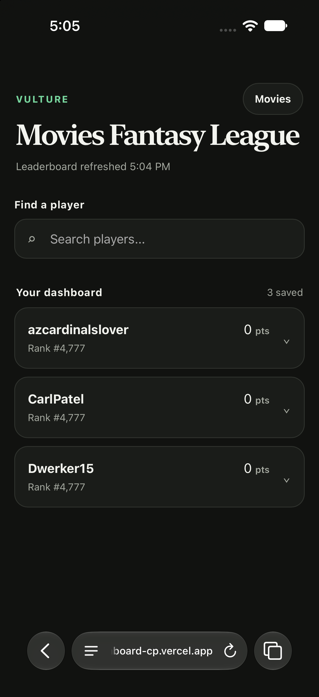
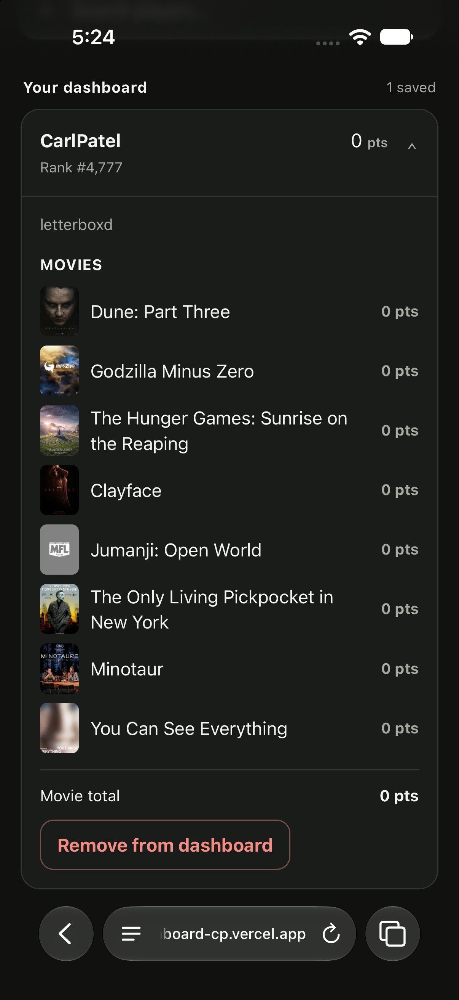
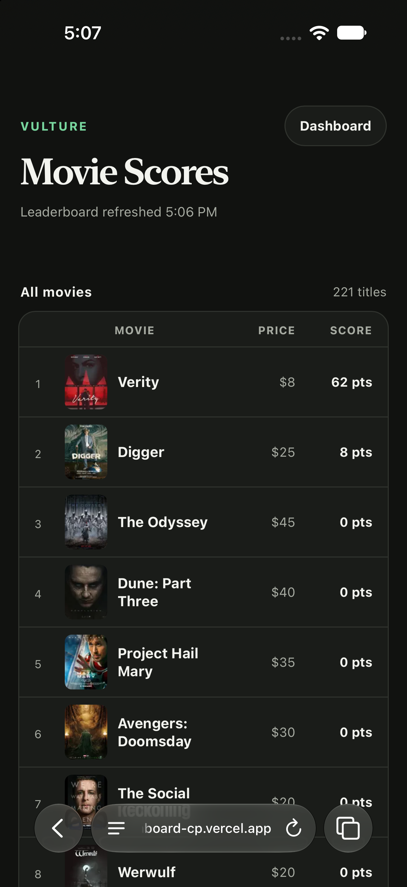

# MFL Dashboard

MFL Dashboard is a mobile-first Next.js application for following players and movie scores in Vulture's Movies Fantasy League. It provides searchable player profiles, shareable saved dashboards, and a complete view of the original movie draft pool.

<table align="center">
  <tr>
    <td width="33%" align="center">
      
    </td>
    <td width="33%" align="center">
      
    </td>
    <td width="33%" align="center">
      
    </td>
  </tr>
</table>

## Vulture Leaderboard Data

The application retrieves Vulture's full leaderboard JSON on the server. It validates and normalizes player names, rankings, total scores, leagues, and selected movies before making that data available to the rest of the application.

The processed leaderboard is cached in server memory for one hour. Player searches, saved-player lookups, and movie-score calculations reuse the same cached data instead of repeatedly downloading the large source file. Concurrent requests also share a single in-progress download.

The leaderboard comes from Vulture's undocumented endpoint:

`https://www.vulture.com/static/leaderboard/production/cmuec30my000h3b7egrtm2p6h.json`

Because this endpoint is undocumented, its URL or response format could change without notice.

## Original Movie Data

The complete movie catalog begins with `app/movies/original-data.json`. This file preserves the original draft choices even when Vulture later removes movies that can no longer be drafted.

For each movie, the application reads:

- Movie title
- Original draft price
- Poster image
- Original position used for score tie-breakers

If a movie appears in the leaderboard but is missing from the original draft file, it is still added to the catalog. Movies without artwork use the default Vulture MFL poster.

## Movie-Score Calculation

Vulture provides each player's total score and eight selected movies, but it does not provide the point value of each individual movie. MFL Dashboard derives those values from the full leaderboard.

Every player's roster creates an equation:

`movie 1 + movie 2 + … + movie 8 = player total score`

Thousands of different rosters produce a large system of equations. The application solves it in stages:

1. A zero-point roster establishes that every movie on that roster is currently worth zero points.
2. Known values are repeatedly substituted into other rosters.
3. Any equation with one remaining unknown reveals that movie's score.
4. Remaining equations are represented as a matrix and reduced to identify values with one unique solution.
5. Only non-negative, effectively integer results are accepted.
6. Ambiguous scores remain unknown instead of being guessed.

The inferred values are validated by adding each player's eight movie scores and comparing the result with the player's official Vulture total. Vulture's player total remains authoritative.

The inferred scores and completed movie catalog are cached against the current leaderboard version. They are recalculated only when the one-hour leaderboard cache retrieves new data.

Development diagnostics are available at `/api/debug/movie-scores`.

## Saved Players and Sharing

Saved usernames are stored in the browser's local storage. This allows a user's dashboard to return when they visit the bare website address again on the same browser and device.

The same usernames are also written into the URL:

`?users=CarlPatel,Dwerker15`

This makes a dashboard bookmarkable and shareable. When a URL includes a user list, that list takes precedence and is also saved locally. Adding or removing a player updates both local storage and the URL without reloading the page.

On touch devices, pulling down from the top refreshes the dashboard from the server. The one-hour server cache still applies.

## Data and Privacy

All Vulture leaderboard requests happen on the server. The browser only receives the players or search results required for the current screen and never downloads or parses the complete leaderboard.

The application does not require:

- User accounts or authentication
- A database
- Vulture cookies
- API keys or client-side secrets
- Personal information beyond the usernames a visitor chooses to save

Saved usernames remain in the visitor's browser through local storage and may also appear in the shareable URL. Anyone who receives a shared dashboard URL can see the usernames included in it.

Poster images are loaded from Vulture's NYMag image host. No generated leaderboard data is committed to the repository.

## Local Development

Install dependencies and start the development server:

```bash
npm install
npm run dev
```

Open `http://localhost:3000`.

Run the project checks with:

```bash
npm test
npm run lint
npm run typecheck
npm run build
```

The application requires no database, secrets, cookies, or environment variables. It can be deployed directly to Vercel using the default Next.js build settings.
